# Expense Tracker

A local-first personal expense tracker built with Flutter, Dart and SQLite for
the Mobile Development final project.

## Features

- **Create, read, update, delete** expenses (title, amount, category, date, note)
- **Seven screens**: Splash, Home, Expense List, Add, Edit, Details, About
- **Form validation**: empty/short title, empty or non-numeric amount, amount
  `<= 0`, missing category, missing date
- **Conditional logic**: monthly total, per-category totals, monthly budget with
  an over-budget warning, empty states
- **Local storage only**: expenses in SQLite (`sqflite` + `sqflite_common_ffi`
  for desktop), monthly budget in `SharedPreferences`; works fully offline
- **Cross-platform**: runs on Android, iOS, Linux, macOS and Windows
- **Currency**: Philippine peso (`₱`) formatting via `intl`

## Project structure

```
lib/
├── main.dart                     app entry point
├── data/
│   ├── database_helper.dart      SQLite singleton: schema + CRUD + totals
│   └── budget_service.dart       monthly budget in SharedPreferences
├── models/
│   ├── expense.dart              record + toMap/fromMap/copyWith
│   └── expense_category.dart     7 fixed categories
├── screens/
│   ├── splash_screen.dart
│   ├── main_shell.dart           bottom navigation (Home / Expenses / About)
│   ├── home_screen.dart
│   ├── expense_list_screen.dart
│   ├── expense_form_screen.dart  add + edit
│   ├── expense_details_screen.dart
│   └── about_screen.dart
├── theme/                        colours, type scale, spacing, Material theme
├── utils/                        formatters, category visuals, fade route
└── widgets/                      AppCard, ExpenseTile, CategoryBadge, ...
```

## Database schema

```sql
CREATE TABLE expenses (
  id INTEGER PRIMARY KEY AUTOINCREMENT,
  title TEXT NOT NULL,
  amount REAL NOT NULL CHECK (amount > 0),
  category TEXT NOT NULL,
  date TEXT NOT NULL,
  note TEXT NOT NULL DEFAULT '',
  created_at TEXT NOT NULL
);
```

Dates are stored as ISO-8601 strings, which makes monthly range queries simple
and human-readable: `WHERE date >= ? AND date < ?`.

## Design

- https://www.figma.com/design/swtIU6lQO9ykeKSDu3SQCw/Expense-Tracker---Mobile-App-Design?node-id=0-1&t=XPvP3MP8aJ113doy-1

## Quick start

```bash
cd expense_tracker
flutter pub get
flutter run          # runs on the connected device or desktop
```

On **desktop** (Linux/macOS/Windows), the app runs natively — no emulator
needed. On **Android**, connect a device or launch an emulator first:

```bash
flutter emulators --launch Medium_Phone_API_37.0   # if using the bundled AVD
flutter run
```

Other commands:

```bash
flutter test         # 6 tests: model round-trip, categories, form validation
flutter analyze      # static analysis
flutter build apk --release
```

## Screenshots

Captured on an Android emulator (1080 × 2400) from the release build:

| | |
| --- | --- |
| 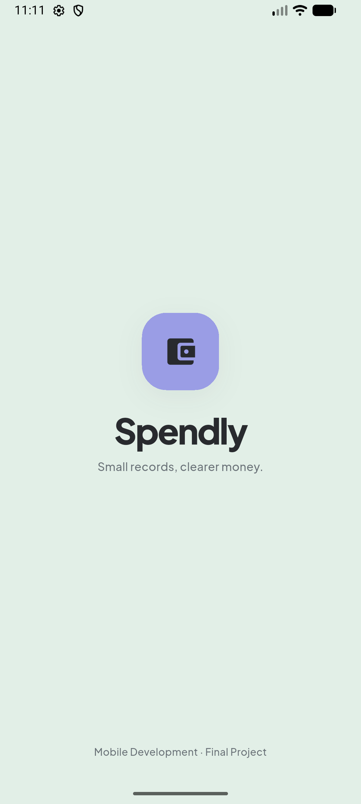 | 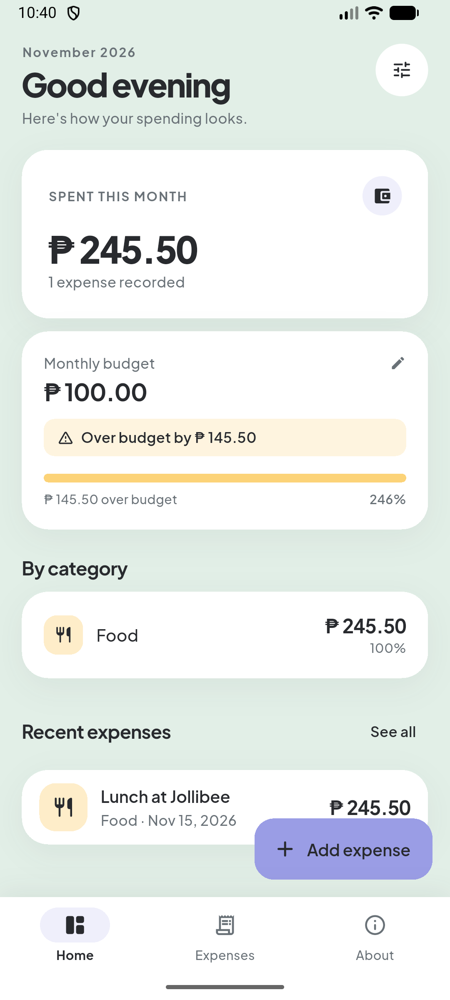 |
| Splash | Home (over-budget state) |
| 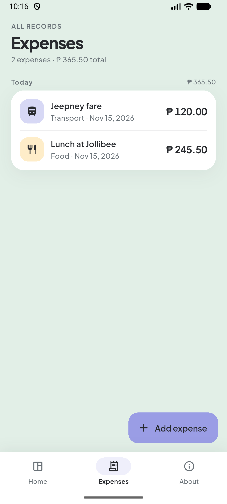 | 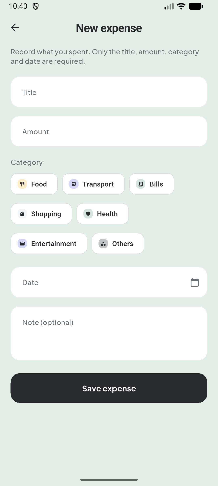 |
| Expense list, grouped by day | Add expense |
| 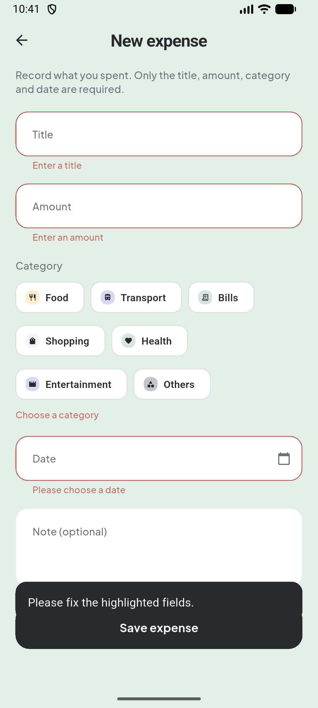 | 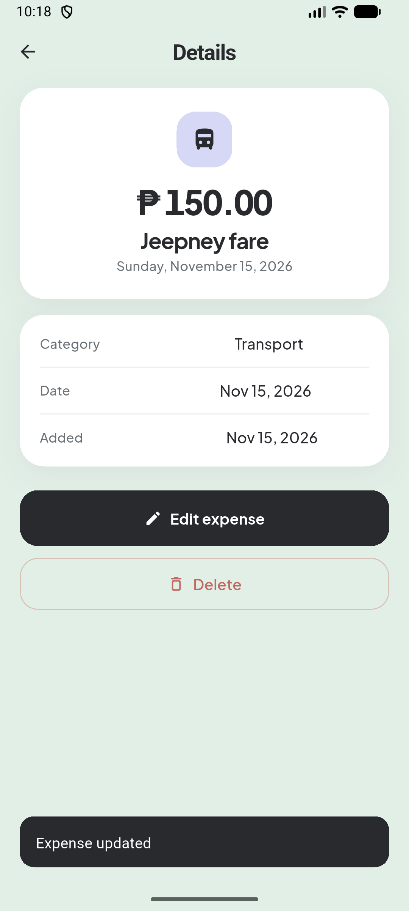 |
| Inline validation errors | Details |
| 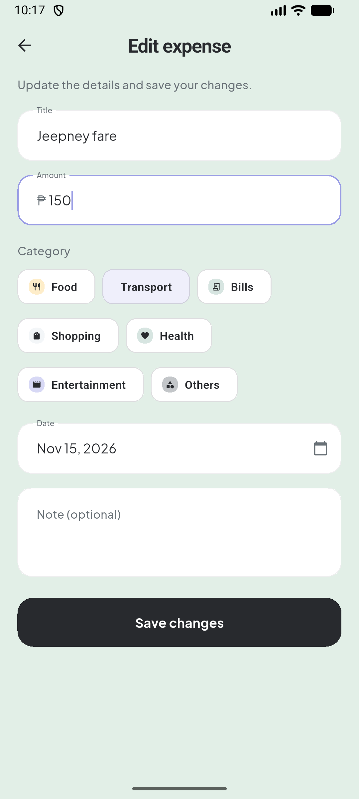 | 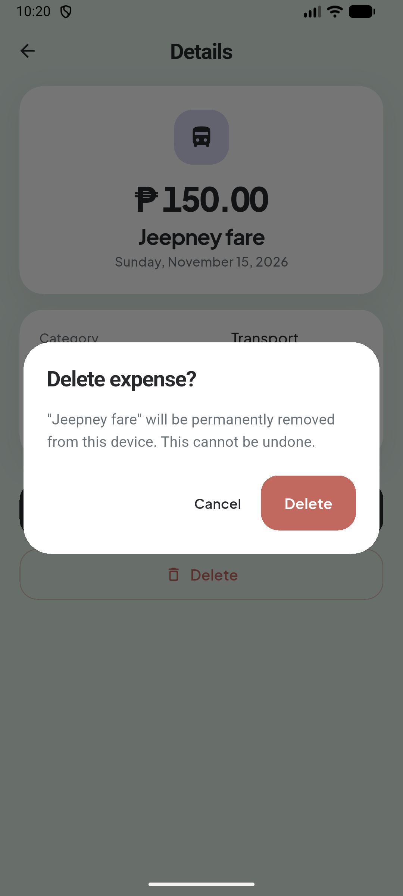 |
| Edit (same form, prefilled) | Delete confirmation |
| 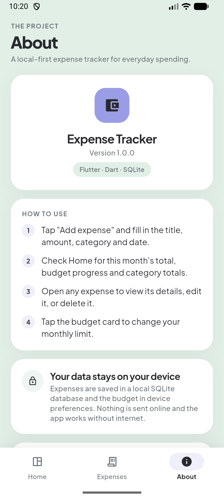 | 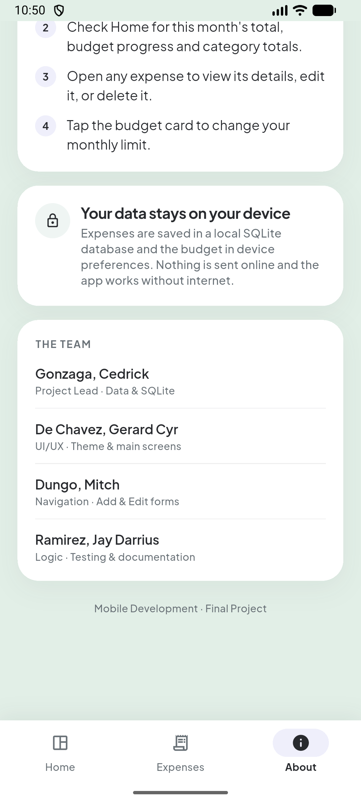 |
| About | About — team |
| 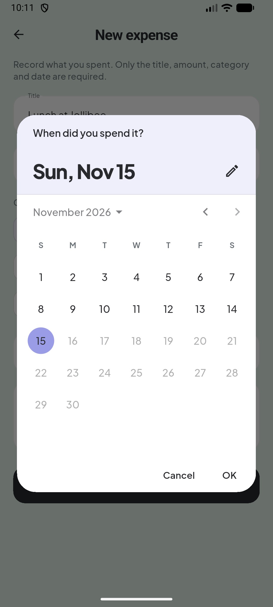 | |
| Date picker | |

Defense preparation notes (15 likely questions answered from this code) are in
[`expense_tracker/docs/DEFENSE_NOTES.md`](expense_tracker/docs/DEFENSE_NOTES.md).

## Team

| Member | Role |
| --- | --- |
| Gonzaga, Cedrick | Project lead, data layer (model, SQLite, CRUD) |
| De Chavez, Gerard Cyr | UI/UX, theme, Home and List screens |
| Dungo, Mitch | Navigation, Add/Edit forms, Details screen |
| Ramirez, Jay Darrius | Logic, testing, About screen, documentation |
